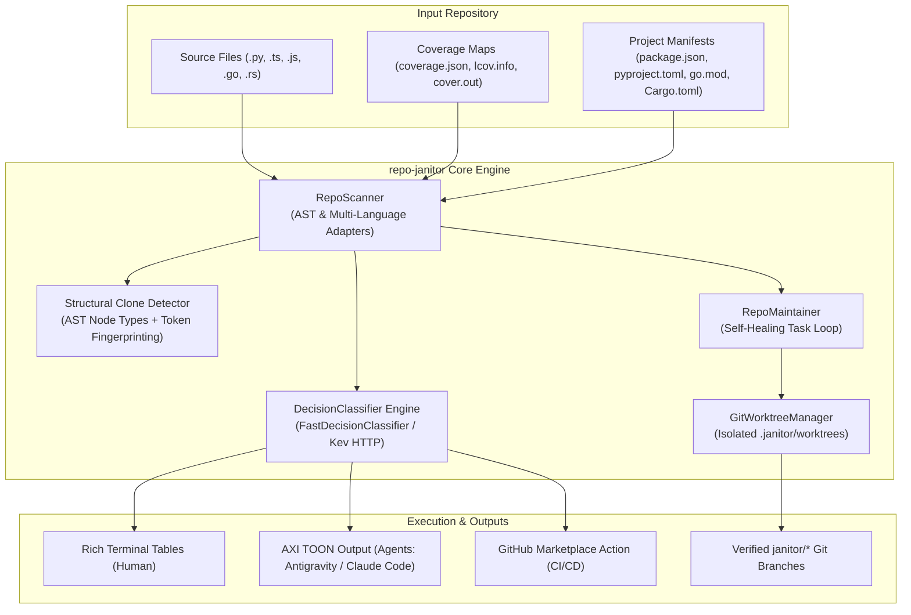

# Architecture of Repo Janitor (`repo-janitor`)

`repo-janitor` is designed as a modular, local-first repository hygiene auditor and autonomous maintainer. It combines static structural inspection, lightweight single-pass decision models (Kev / System-One), and isolated Git worktree sandboxing.

---

## 1. High-Level System Architecture



---

## 2. Core Subsystems

### A. Multi-Language Adapters (`src/repo_janitor/languages.py`)
Decouples syntax parsing, test discovery, and doc-comment placement from the main engine:
- **`PythonAdapter`**: AST body inspection, PEP 257 docstring injection (`"""..."""` inside target bodies), `pytest` test runners, `coverage.json`.
- **`TypeScriptJSAdapter`**: JSDoc/TSDoc parsing (`/** ... */` placed above class/function declarations), `vitest`/`jest` runners, `lcov.info` coverage, and automated `node_modules` junction/symlink sharing into worktrees.
- **`GoAdapter`**: GoDoc comments (`// Symbol ...` above declarations), `go test ./...`, and `cover.out` profile integration.
- **`RustAdapter`**: Rustdoc (`/// ...` placed above preceding `#[...]` attributes), `cargo test --quiet`, and `lcov.info`.

### B. Tri-Bucket Auditor (`src/repo_janitor/scanner.py` & `classifier.py`)
Scans any codebase into three structured categories:
1. **Errors**:
   - Syntax and parser failures (`node --check`, `ast.parse`).
   - Broken internal module imports (detecting references to non-existent local targets).
   - Silent exception swallows (`except: pass` or empty catch blocks).
2. **Gaps**:
   - Unimplemented stubs (`pass`, `...`, `raise NotImplementedError`).
   - Untested public functions/methods (correlated against line coverage or static test corpus lookups).
   - Missing docstrings and public API documentation.
3. **Redundancies**:
   - **Type 2/3 Code Clones**: Tokenizes code into AST node sequences or normalized keywords/operators, generating 2-gram shingles and calculating pairwise Jaccard similarity ($\ge 85\%$) across functions.
   - **Dead Code**: Builds an intra-repository symbol reference graph, flagging symbols with 0 external callers (excluding framework entrypoints like `main`, `app`, `cli`).

### C. Decision Classifier Pipeline (`src/repo_janitor/classifier.py`)
Rather than relying on slow, non-deterministic autoregressive LLM text generation, `repo-janitor` evaluates findings through single-pass decision classifiers:
- **`FastDecisionClassifier`**: Zero-dependency heuristic model providing calibrated confidence scores and actionable recommendations in $<1\text{ms}$.
- **`KevDecisionClassifier`**: Connects via HTTP to local Kev / System-One decision models to classify structured JSON schemas in $\sim 15\text{ms}$.

### D. Isolated Git Worktree Sandboxing (`src/repo_janitor/worktree.py`)
Autonomous fixes and test generation never modify dirty working trees or active branches:
1. Allocates an ephemeral worktree in `.janitor/worktrees/<task>`.
2. Creates and checks out a new branch (`janitor/<category>/<slug>`).
3. For JS/TS projects, links `node_modules` into the worktree so tests run without reinstalling packages.
4. Injects changes and executes the project's native test runner (`pytest`, `vitest`, `go test`, `cargo test`).
5. **Self-Healing Loop**: If verification fails, the failure traceback is fed back to the generator (up to `max_retries`).
6. **Integrity Guard**: Unlinks shared dependencies and removes the worktree. If the task passed, the branch is retained for review; if verification failed, the branch is deleted.

---

## 3. Data Flow & Agent Ergonomics (AXI TOON)

When invoked with `--toon`, `repo-janitor` emits compact Token-Oriented Object Notation:

```text
repo: C:/Users/ashmi/Documents/Projects/my-app
summary: 0 errors, 2 gaps, 0 redundancies across 13 files
errors: 0 findings
gaps[2]{kind,file,line,conf,actionable,rec}:
  untested_function,src/services/EventBus.js:36,0.75,true,Add unit test suite covering `wrappedCallback`.
  untested_function,src/utils/formatters.js:62,0.75,true,Add unit test suite covering `later`.
redundancies: 0 findings
```

This reduces agent context token usage by $\sim 50\text{--}70\%$ compared to Markdown tables or JSON payloads while ensuring deterministic regex parsing.
