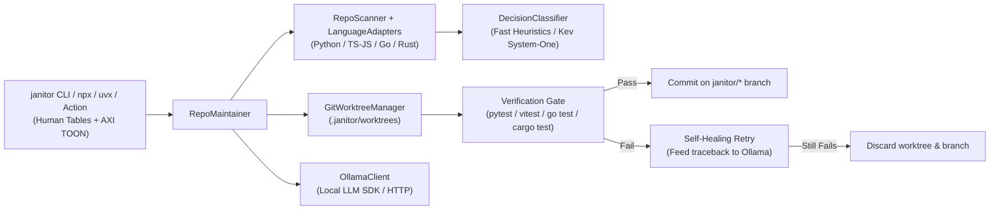

# Repo Janitor (`repo-janitor`)

[](LICENSE)
[](https://www.python.org/)
[](#multi-language-support)
[](#agent-skill-integration)

An autonomous, multi-language repository auditor and hygiene maintainer for **Python, TypeScript/JavaScript, Go, and Rust**. 

`repo-janitor` scans codebases for **Errors** (syntax failures, broken imports, empty exception swallows), **Gaps** (unimplemented stubs, untested functions, missing docstrings), and **Redundancies** (code clones, dead code) using lightweight decision models (**Kev** / **FastDecisionClassifier**). It can autonomously generate verified unit tests and docstrings inside **isolated Git worktrees** without ever dirtying your active working tree.

---

## Architecture



---

## Key Features

1. **Tri-Bucket Hygiene Auditor (`janitor check` / `janitor audit`)**:
   - **Errors**: Catches syntax/parse failures, unresolvable internal imports, and silent `except: pass` exception swallows.
   - **Gaps**: Surfaces unfinished stubs (`pass`, `...`, `raise NotImplementedError`), untested public functions, and undocumented exports.
   - **Redundancies**: Detects Type-2/3 code clones across files using structural AST/token shingles ($\ge 85\%$ similarity) and flags uncalled dead code.

2. **Kev & Fast Decision Classifiers**:
   - Uses single-pass decision models (`FastDecisionClassifier` or local Kev / System-One HTTP models) that return discrete confidence scores, actionable booleans, and recommendations in $<30\text{ms}$ without slow autoregressive token decoding.

3. **Multi-Language Support**:
   - Out-of-the-box adapters for **Python** (PEP 257 + `pytest` + `coverage.json`), **TypeScript/JavaScript** (JSDoc/TSDoc + `vitest`/`jest` + `lcov.info`), **Go** (GoDoc + `go test` + `cover.out`), and **Rust** (Rustdoc + `cargo test` + `lcov.info`).

4. **Zero-Pollution Git Worktree Sandboxing**:
   - Never touches your dirty working tree or active branch. Tasks run inside ephemeral `.janitor/worktrees/<task>` directories, share dependencies (`node_modules`), commit to isolated `janitor/*` branches, and clean up automatically.

5. **Self-Healing Test Verification**:
   - Executes the project's native test runner before committing. If a generated test fails, the traceback is fed back to the generator (up to `max_retries`) to self-correct. Unverified branches are deleted automatically.

6. **Dual Human & Agent-Native Interface (AXI TOON)**:
   - Formatted Rich tables for terminal users, plus `--toon` (Token-Oriented Object Notation) for AI agents (Antigravity, Claude Code, Cline, Windsurf), cutting context token consumption by $\sim 50\text{--}70\%$.

---

## Quickstart

### Option A: Zero-Install On-Demand Runner (Like `npx fallow`)

You can run `repo-janitor` on demand inside the root of any repository without pre-installing a binary:

```bash
# In any project root via npx:
npx repo-janitor check

# Or via uvx (instant execution in an ephemeral sandbox):
uvx repo-janitor check

# Agent-friendly compact TOON output:
npx repo-janitor check --toon
```

### Option B: Local Installation (Global CLI)

```bash
pip install -e .
```

Make sure Ollama is running if you want autonomous LLM test generation:
```bash
ollama pull qwen2.5-coder:7b
```

### Option C: GitHub Marketplace Action (CI/CD Quality Gate)

Add `.github/workflows/repo-janitor.yml` to automatically audit pull requests:

```yaml
name: Repo Janitor Codebase Intelligence

on:
  pull_request:
    branches: [ main ]

jobs:
  audit:
    runs-on: ubuntu-latest
    steps:
      - name: Checkout Code
        uses: actions/checkout@v4

      - name: Run Repo Janitor
        uses: iamnottheone99/repo-janitor@master
        with:
          command: check
          strict: true # Fails the workflow if errors are detected
          format: table # or 'toon'
```

---

## CLI Command Reference

Run commands directly from the root of any repository:

| Command | Description |
| :--- | :--- |
| `janitor check` | Run tri-bucket hygiene audit (**Errors**, **Gaps**, **Redundancies**). |
| `janitor check --toon` | Emit compact, machine-readable AXI TOON output for agents. |
| `janitor check --classifier kev` | Use local Kev / System-One decision model for classification. |
| `janitor check --strict` | Exit with code `1` if errors are found (ideal for CI pipelines). |
| `janitor scan` | Inspect missing docstrings, untested functions, and README drift. |
| `janitor docstrings` | Generate missing docstrings and update README on `janitor/docs/*` branches. |
| `janitor tests --limit 3` | Generate unit tests for uncovered functions on `janitor/tests/*` branches. |
| `janitor run` | Run full autonomous maintenance pass (docstrings + README + tests). |
| `janitor branches` | List verified `janitor/*` branches ready for merge. |
| `janitor prune` | Remove all local `janitor/*` branches and clean stale worktrees. |

---

## Agent Skill Integration

`repo-janitor` conforms to the **Agent eXperience Interface (AXI)** standard.

### Antigravity & Claude Code
Add [`skills/repo-janitor/SKILL.md`](skills/repo-janitor/SKILL.md) to your agent skills directory (e.g. `~/.gemini/config/skills/repo-janitor/SKILL.md` or `~/.claude/skills/repo-janitor/SKILL.md`). Agents will automatically use `janitor check --toon` to audit codebases with zero token bloat.

### TOON Output Format
```text
repo: C:/Users/ashmi/Documents/Projects/my-app
summary: 0 errors, 2 gaps, 0 redundancies across 13 files
errors: 0 findings
gaps[2]{kind,file,line,conf,actionable,rec}:
  untested_function,src/services/EventBus.js:36,0.75,true,Add unit test suite covering `wrappedCallback`.
  untested_function,src/utils/formatters.js:62,0.75,true,Add unit test suite covering `later`.
redundancies: 0 findings
```

---

## Configuration (`.janitor.json`)

Customize repository settings by placing `.janitor.json` in your repository root:

```json
{
  "language": "auto",
  "model": "qwen2.5-coder:7b",
  "ollama_host": "http://localhost:11434",
  "classifier_model": "fast",
  "temperature": 0.1,
  "max_retries": 2,
  "similarity_threshold": 0.85,
  "min_clone_lines": 3,
  "branch_prefix": "janitor",
  "worktree_dir": ".janitor/worktrees",
  "test_command": "auto",
  "source_dirs": ["src", "."],
  "tests_dir": "tests",
  "include_private_symbols": false,
  "max_tasks_per_run": 5
}
```

---

## Project Layout

- `src/repo_janitor/classifier.py` — Decision classifier protocol, `FastDecisionClassifier`, `KevDecisionClassifier`, and AST clone detection
- `src/repo_janitor/languages.py` — `LanguageAdapter` implementations (`PythonAdapter`, `TypeScriptJSAdapter`, `GoAdapter`, `RustAdapter`)
- `src/repo_janitor/scanner.py` — Tri-bucket auditor (`RepoScanner.audit`), AST parser, and coverage loader
- `src/repo_janitor/worktree.py` — `GitWorktreeManager` for isolated worktrees, dependency linking, and branch hygiene
- `src/repo_janitor/maintainer.py` — `RepoMaintainer` self-healing task loop orchestrator
- `src/repo_janitor/ollama_client.py` — Local LLM generator with language-aware prompts
- `src/repo_janitor/cli.py` — Typer CLI with Rich tables, `--strict` CI gating, and `--toon` output
- `action.yml` — GitHub Marketplace Action specification
- `tests/test_janitor.py` — End-to-end pytest suite verifying multi-language scanning, worktree isolation, clone detection, and rollback

---

## License

Released under the [MIT License](LICENSE).
