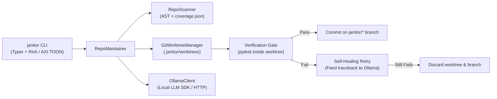

# Repo Janitor (`repo-janitor`)

An autonomous, local **Ollama-powered** repository maintainer that scans Python codebases for missing docstrings, outdated `README.md` module documentation, and uncovered functions — applying and verifying every change inside **isolated Git worktrees** (`janitor/<task>/<slug>`) before committing.

---

## Architecture



### Key Features
1. **Zero-Cloud Privacy**: Runs 100% locally against your Ollama server (`qwen2.5-coder:7b`, `deepseek-coder-v2`, `llama3.1`, etc.).
2. **Isolated Git Worktree Sandboxing**: Never touches your dirty working tree or active branch. Every task spins up `.janitor/worktrees/<task>`, creates a `janitor/docs/*` or `janitor/tests/*` branch, and cleans up the worktree directory automatically.
3. **Self-Healing Test Verification**: Runs `pytest` inside the isolated worktree before committing. If a generated unit test fails, the pytest traceback is fed back to Ollama (up to `max_retries`) to self-correct. Unverified branches are automatically discarded.
4. **Dual Human & Agent (AXI TOON) CLI**: Rich tables for interactive terminal use, plus `--toon` (Token-Oriented Object Notation) for autonomous agents.

---

## Quickstart

### 1. Install
```bash
pip install -e ".[dev]"
```

### 2. Pull a Local Coding Model in Ollama
```bash
ollama pull qwen2.5-coder:7b
```

### 3. Initialize & Scan Any Git Repo
```bash
# Create .janitor.json config in target repo
janitor init --repo /path/to/repo --model qwen2.5-coder:7b

# Scan for missing docstrings, untested functions, and README drift
janitor scan --repo /path/to/repo

# Agent-friendly TOON output
janitor scan --repo /path/to/repo --toon
```

### 4. Run Autonomous Maintenance
```bash
# Generate missing docstrings & update README in isolated janitor/docs/* branches
janitor docstrings --repo /path/to/repo

# Generate unit tests for uncovered functions in isolated janitor/tests/* branches
janitor tests --repo /path/to/repo

# Run full autonomous pass (docstrings + README + unit tests)
janitor run --repo /path/to/repo --limit 5

# Inspect or merge verified branches
janitor branches --repo /path/to/repo
git merge janitor/tests/math_ops-add

# Clean up janitor/* branches when done
janitor prune --repo /path/to/repo
```

---

## Project Layout

- `src/repo_janitor/config.py` — `JanitorConfig` settings and `.janitor.json` persistence
- `src/repo_janitor/scanner.py` — `RepoScanner` AST symbol parser, `coverage.json` reader, and README drift detector
- `src/repo_janitor/ollama_client.py` — `OllamaClient` wrapper with SDK + native HTTP fallback
- `src/repo_janitor/worktree.py` — `GitWorktreeManager` for isolated git worktree creation, test execution, and branch hygiene
- `src/repo_janitor/maintainer.py` — `RepoMaintainer` orchestrator & AST-safe docstring injector
- `src/repo_janitor/cli.py` — `janitor` Typer CLI with Rich tables and `--toon` output
- `tests/test_janitor.py` — End-to-end test suite verifying AST scanning, worktree isolation, self-healing retries, and rollback
